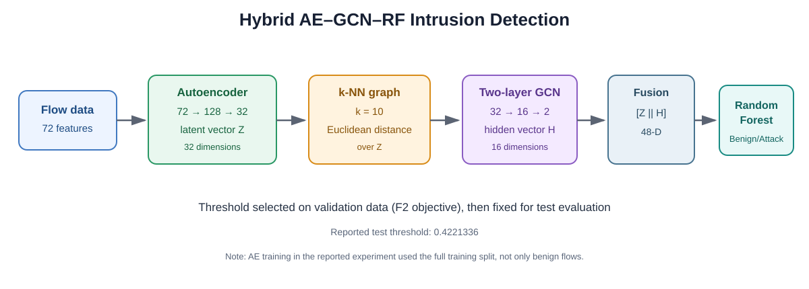
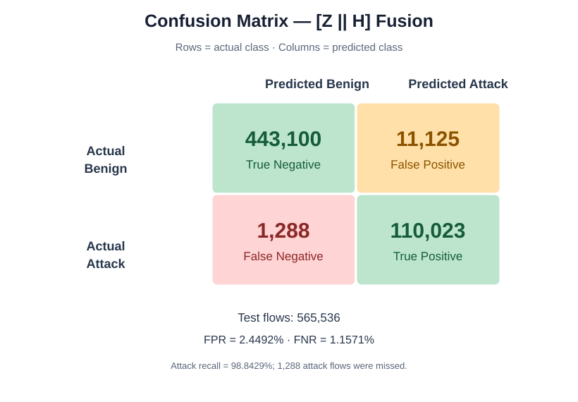
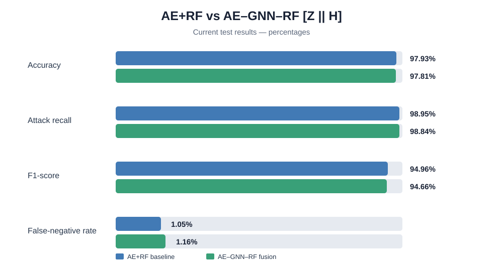

# Hybrid AE–GNN–RF IDS Research

A research repository documenting an Autoencoder (AE) + Graph Convolutional Network (GCN) + Random Forest pipeline for binary intrusion detection using the CIC-IDS2017 dataset.

> **Research status:** the current results do not show that AE–GNN–RF outperforms the AE+RF baseline overall. The repository reports that honestly and identifies controlled follow-up experiments to test whether graph-derived relational features improve a specific cybersecurity objective.

## Architecture

- **Input:** 72 numeric traffic features after cleaning and exclusion of identifier/time columns.
- **Autoencoder:** encoder 72 → 128 → 32; decoder 32 → 128 → 72. The 32-dimensional latent representation is **Z**.
- **Graph:** k-nearest-neighbour graph over Z, with k = 10 and Euclidean distance.
- **GCN:** two layers, 32 → 16 → 2. The 16-dimensional hidden representation is **H**.
- **Fusion:** **F = [Z || H]**, giving 48 features.
- **Classifier:** Random Forest with 100 trees, max depth 15, `max_features="sqrt"`, balanced class weights, random state 42.
- **Threshold:** 0.4221336, selected on validation data by maximising F2, then frozen for final test evaluation.

**Important implementation detail:** in the reported experiment, the AE was trained on the full training split, including benign and attack flows; it was not trained exclusively on benign samples.

## Final reported test result: [Z || H] fusion

| Metric | Result |
|---|---:|
| Accuracy | 97.8051% |
| Attack precision | 90.817% |
| Attack recall | 98.8429% |
| F1-score | 94.6601% |
| ROC-AUC | 0.998172 |
| Average precision (AP) | 0.992614 |
| False-positive rate (FPR) | 2.4492% |
| False-negative rate (FNR) | 1.1571% |
| Balanced accuracy | 98.1968% |

The held-out test set contains 565,536 flows: 454,225 benign and 111,311 attack flows. The confusion matrix is TN = 443,100, FP = 11,125, FN = 1,288, TP = 110,023.

## Baseline comparison

The AE+RF baseline is slightly stronger on current overall results: about 97.93% accuracy, 94.96% F1, 98.95% attack recall, and 1.05% FNR. The [Z || H] fusion is much stronger than the RF(H)-only experiment in the reported comparison, but it does not establish an overall win over AE+RF.

The scientific question for the next experiment is whether the GNN gives a measurable benefit under a defined condition, such as a **fixed target attack recall with lower FPR**, better detection of particular attack classes, or stronger cross-day generalisation. Any threshold must be selected with validation data, not tuned against the final test set.

## Repository layout

- `notebooks/01_results_and_metrics_audit.ipynb` — inspects committed result tables, recomputes selected metrics from the confusion matrix, and visualises the reported comparison.
- `notebooks/02_cicids2017_cleaning_audit.ipynb` — audits locally stored CIC-IDS2017 CSVs and documents cleaning steps.
- `figures/` — text-based SVG architecture, confusion matrix, and model-comparison figures.
- `results/` — reported metrics, ablation comparison, class counts and cleaning-audit CSVs.
- `docs/RESEARCH_STATUS.md` — claims supported by the current experiment and outstanding research questions.
- `docs/REPRODUCIBILITY.md` — recorded configuration and environment notes.

The notebooks in this repository audit the stored results and data-cleaning process; they **do not rerun the complete historic training pipeline**. The committed metrics are records of the previously completed experiment, not evidence that training was freshly reproduced from this repository.

## Data cleaning and limitations

The recorded merge contained 3,119,345 rows and 85 columns including the label. Removing rows containing missing/non-finite values left 2,827,876 rows. Removing 199 duplicate rows left 2,827,677 rows, with 2,271,122 benign and 556,555 attack flows. Eight constant non-label columns were removed; four non-numeric identifier/time fields (Flow ID, Source IP, Destination IP, Timestamp) were excluded from model inputs, leaving 72 numeric features.

The Thursday Web Attacks CSV had a substantial data-quality issue: 288,602 missing-label rows, 288,622 rows with any missing value, and 135 rows with an infinite numeric value (20 overlap with rows containing missing values). The cleaning rule removed the union of these cases from that file. Confirm the exact source files and cleaning policy before treating the cleaned data as definitive.

The stored result files describe a single dataset and one evaluation setup. They do not establish deployment latency, online detection capability, cross-day generalisation, or performance on unseen attack families. The full training workload is memory-intensive. Any changed split, sampling, batching, or preprocessing must be documented as a different run.

## Reproduce the audits

1. Create a Python environment and install `requirements.txt`.
2. Download CIC-IDS2017 independently from its official distribution.
3. Put the eight source CSVs under `data/raw/` (the raw data is ignored by Git and is not included here).
4. Launch Jupyter from the repository root.
5. Run the cleaning-audit notebook and check the observed counts against the committed audit CSVs. Investigate discrepancies rather than adjusting data to force a match.

The exact historical run should be treated as not fully reproduced until the training pipeline is rerun from raw data in a clean environment and all results are independently verified.

## License

MIT. See [LICENSE](LICENSE).
