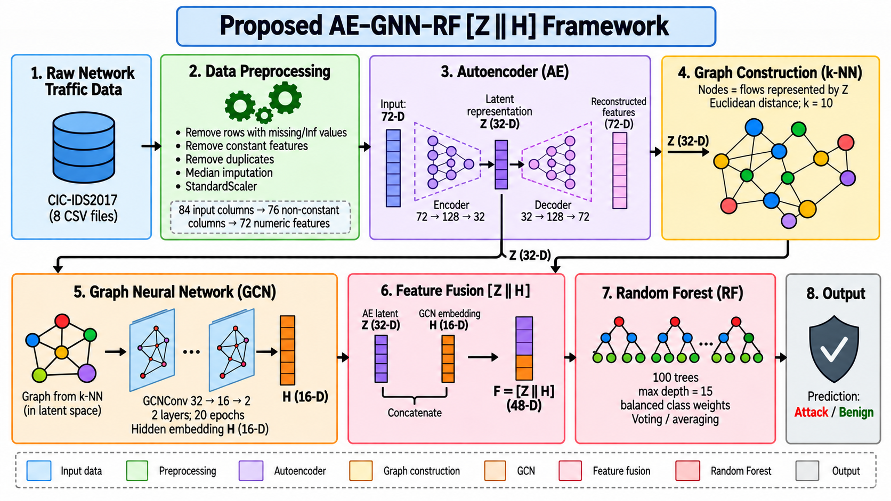
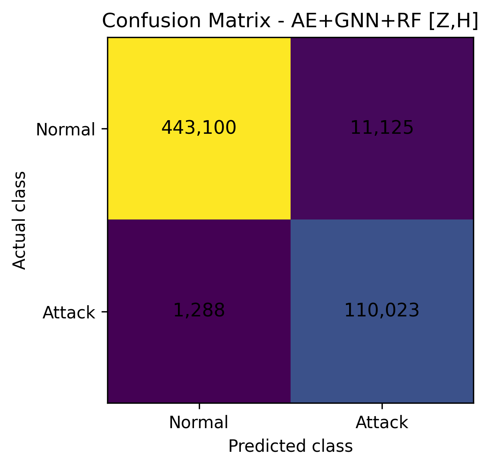
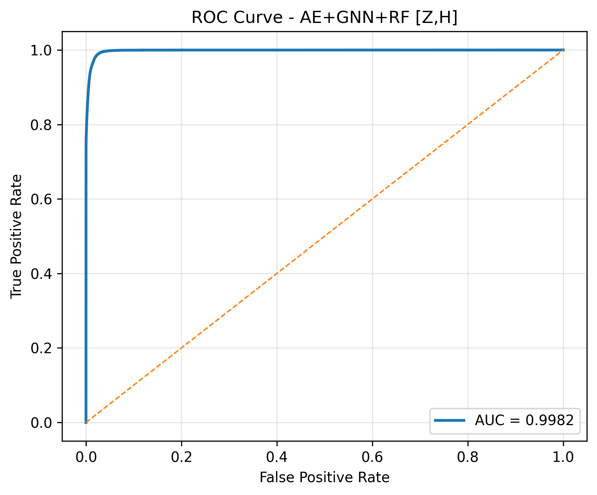
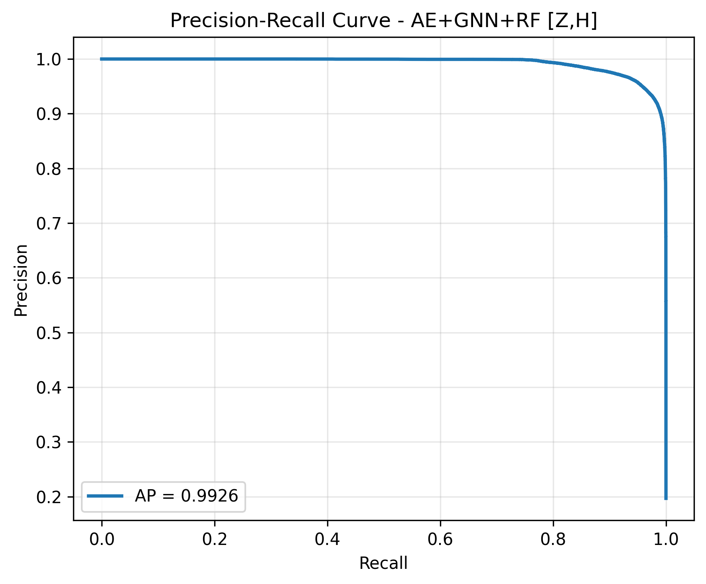
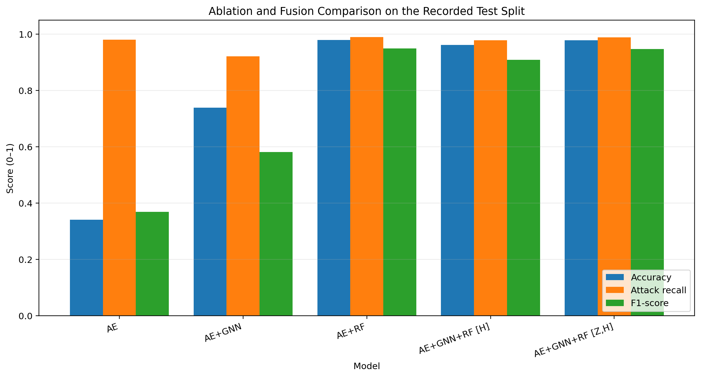

# Hybrid AE–GNN–RF Intrusion Detection (CIC-IDS2017)

An experimental research implementation of network intrusion detection using an Autoencoder (AE), a k-nearest-neighbour (k-NN) graph, a Graph Convolutional Network (GCN), and a Random Forest (RF) classifier.

> **Research status:** experimental benchmark code. The manuscript has been shared with the academic supervisor for review; this repository does not claim peer-reviewed publication, production readiness, or generalization to unseen networks. The current results do **not** show that GNN fusion outperforms the AE+RF baseline overall.

## Architecture



The principal fused model is:

`72 numeric flow features → AE encoder → Z (32-D) → k-NN graph (k=10) → GCN hidden embedding H (16-D) → concatenate [Z || H] (48-D) → RF → benign / attack`

The notebook also evaluates an H-only RF baseline and a supplementary `[Z || reconstruction error || H]` (49-D) variant.

## Archived result for [Z || H] (separate experiment protocol)

This archived fusion run evaluated **565,536 test flows** using a validation-selected decision threshold of **0.4221336**.

| Metric | Result |
|---|---:|
| Accuracy | 97.8051% |
| Attack precision | 90.8170% |
| Attack recall | 98.8429% |
| Attack F1-score | 94.6601% |
| ROC-AUC | 0.998172 |
| Average Precision (AP) | 0.992614 |
| False-positive rate | 2.4492% |
| False-negative rate | 1.1571% |
| Balanced accuracy | 98.1968% |

Confusion matrix (rows = actual; columns = predicted):

| | Predicted benign | Predicted attack |
|---|---:|---:|
| Actual benign | 443,100 | 11,125 |
| Actual attack | 1,288 | 110,023 |







*Metric note:* the stored `PR_AUC` value was computed with scikit-learn's `average_precision_score`, so this README calls it **Average Precision (AP)** rather than implying trapezoidal integration of the precision–recall curve.

## Archived ablation and fusion comparison (separate protocol)

All metrics below come from the recorded benchmark runs. The `model_comparison.csv` file stores metric scores as fractions from 0 to 1, and confusion-matrix entries as counts.

| Model | Accuracy | Precision | Attack recall | F1 | ROC-AUC | FNR |
|---|---:|---:|---:|---:|---:|---:|
| AE | 34.09% | 22.74% | 97.99% | 36.92% | 0.6646 | 2.01% |
| AE+GNN | 73.89% | 42.47% | 92.16% | 58.15% | 0.8755 | 7.84% |
| AE+RF | **97.93%** | **91.28%** | **98.95%** | **94.96%** | **0.9984** | **1.05%** |
| AE+GNN+RF `[H]` | 96.12% | 84.82% | 97.80% | 90.85% | 0.9952 | 2.20% |
| AE+GNN+RF `[Z || H]` | 97.81% | 90.82% | 98.84% | 94.66% | 0.9982 | 1.16% |



**Interpretation of the archived comparison:** adding Z back to the GNN embedding improves the H-only hybrid in that run, but **AE+RF remains stronger overall** on the listed aggregate metrics. Later aligned and source-day experiments are separate protocols summarized below. Fixed-recall and attack-family analyses have now been run; the Thursday cleaning audit remains open. Cross-dataset evaluation is future work, not a requirement for this manuscript.


## Aligned comparison and Friday source-day stress test

The newer results below use different protocols from the archived result above. Do not combine thresholds or metric values across protocols.

### Aligned random-split benchmark (exploratory)

All variants used a shared 100,000-node validation sample and the same 565,536-flow random-split test partition. This test partition had been inspected in earlier exploration, so it is not an untouched confirmatory test.

| Model | Accuracy | Precision | Attack recall | F1 | ROC-AUC | FPR | FNR |
|---|---:|---:|---:|---:|---:|---:|---:|
| AE reconstruction error | 34.11% | 22.75% | 97.97% | 36.92% | 0.6646 | 81.54% | 2.03% |
| AE+RF [Z,re] | 97.97% | 91.51% | 98.87% | 95.05% | 0.9984 | 2.25% | 1.13% |
| AE+GNN direct scores | 73.89% | 42.47% | 92.16% | 58.15% | 0.8755 | 30.59% | 7.84% |
| AE+GNN+RF [H] | 96.13% | 84.85% | 97.80% | 90.87% | 0.9952 | 4.28% | 2.20% |
| AE+GNN+RF [Z,H] | 97.81% | 90.87% | 98.82% | 94.68% | 0.9982 | 2.43% | 1.19% |
| AE+GNN+RF [Z,re,H] | 97.71% | 90.31% | 98.98% | 94.45% | 0.9982 | 2.60% | 1.02% |

### Friday source-day stress test (exploratory)

AE/GCN/RF were fitted on Monday–Thursday development data; thresholds were selected on development validation; and all 702,713 Friday flows were evaluated as one cohort. Friday was inspected in earlier experiments, so this is a stress test rather than untouched independent confirmation. Bot (1,956 rows), DDoS (128,025 rows), and PortScan (158,804 rows) were absent from the Monday–Thursday development pool.

| Model | Accuracy | Precision | Attack recall | F1 | ROC-AUC | FPR | FNR |
|---|---:|---:|---:|---:|---:|---:|---:|
| AE reconstruction error | 62.14% | 58.19% | 27.95% | 37.76% | 0.5608 | 14.01% | 72.05% |
| AE+RF [Z,re] | 69.56% | 96.22% | 26.99% | 42.15% | 0.7595 | 0.74% | 73.01% |
| AE+GNN direct scores | 69.55% | 93.49% | 27.85% | 42.91% | 0.7715 | 1.35% | 72.15% |
| AE+GNN+RF [H] | 69.09% | 91.60% | 27.28% | 42.04% | 0.8013 | 1.75% | 72.72% |
| AE+GNN+RF [Z,H] | 69.56% | 96.03% | 27.05% | 42.20% | 0.7004 | 0.78% | 72.95% |
| AE+GNN+RF [Z,re,H] | 69.60% | 96.16% | 27.11% | 42.29% | 0.7746 | 0.76% | 72.89% |

At the F2-selected validation thresholds, all evaluated models missed about 72–73% of Friday attacks. Bot recall ranged from 0 to 5.06%, DDoS recall from 60.75 to 62.75%, and PortScan recall from 0.05 to 0.97%. These results should be reported alongside the random-split metrics.

At a validation target recall of 98.8%, test recall was 25.96% for AE+RF [Z,re] (FPR 0.64%) and 26.86% for full fusion [Z,re,H] (FPR 0.71%). Direct AE+GNN reached 99.77% recall but produced a 96.80% FPR. Threshold transfer therefore failed for this source-day shift.

See docs/FRIDAY_SOURCE_DAY_HOLDOUT_AUDIT.md for interpretation and limitations. The GCN graph is built across the whole evaluation cohort, so this is offline cohort inference, not a streaming evaluation. Repeated-seed confidence intervals and latency/throughput measurements are possible additional checks. Cross-dataset validation is future work outside this manuscript's scope.

## Dataset and preprocessing audit

The public CIC-IDS2017 CSVs are **not bundled** in this repository. Download them from the [Canadian Institute for Cybersecurity's CIC-IDS2017 page](https://www.unb.ca/cic/datasets/ids-2017.html), then place the eight source files in:

`data/raw/cicids2017/`

The recorded preprocessing audit is:

| Stage | Count |
|---|---:|
| Merged source data | 3,119,345 rows; 85 columns including label |
| After replacing ±infinity with missing and dropping rows with any missing value | 2,827,876 rows |
| Exact duplicate rows removed | 199 |
| Final rows | 2,827,677 |
| Benign rows after deduplication | 2,271,122 |
| Attack rows after deduplication | 556,555 |
| Model input features | 72 numeric features |

The 76 non-constant feature columns exclude four non-numeric identifiers/time fields (`Flow ID`, `Source IP`, `Destination IP`, `Timestamp`), leaving 72 numeric model inputs.

### ### Data-quality audit (completed)

A follow-up audit of `Thursday-WorkingHours-Morning-WebAttacks.pcap_ISCX.csv` parsed 458,968 records across 85 fields and found 288,602 records that were entirely blank, including the Label field. Those records contain no labelled traffic to recover. Another 135 labelled BENIGN records contained infinite numeric values, of which 20 also had a missing `Flow Bytes/s` value. The invalid-row union excluded 288,737 records and retained 170,231 labelled records before de-duplication: 168,051 BENIGN and 2,180 attacks (1,507 Brute Force, 21 SQL Injection and 652 XSS). The source-file audit recorded one duplicate row removed in de-duplication, leaving 170,230 records from this file. No row had a wrong CSV field count and no whitespace-only cells were reported. The large exclusion count is therefore predominantly blank CSV records, not discarded labelled attack flows.

Compact audit summaries are versioned in `results/thursday_webattacks_audit_summary.csv`, `results/thursday_webattacks_label_counts.csv`, and `results/thursday_webattacks_excluded_rows.csv`. The raw source CSV and detailed per-column output are not bundled.

Do not upload the raw dataset files or generated large model files to GitHub.

## Repository layout

```text
.
├── README.md
├── LICENSE
├── requirements.txt
├── .gitignore
├── notebooks/
│   ├── 01_full_experiment_pipeline.ipynb
│   └── 02_cicids2017_cleaning_audit.ipynb
├── figures/
│   ├── architecture_72d_zh_fusion.png
│   ├── final_zh_confusion_matrix.png
│   ├── final_zh_roc_curve.png
│   ├── final_zh_precision_recall_curve.png
│   └── model_comparison.png
├── results/
│   ├── final_model_metrics.csv
│   ├── model_comparison.csv
│   └── CIC-IDS2017 audit CSVs
└── docs/
    ├── REPRODUCIBILITY.md
    └── RESEARCH_STATUS.md
```

## Run the experiment

1. Use Python 3.10 or 3.11 in a fresh environment.
2. Install PyTorch for your operating system using the [official PyTorch installation selector](https://pytorch.org/get-started/locally/), then install the dependencies in `requirements.txt`. If your platform requires a platform-specific PyTorch Geometric wheel or setup, follow the [PyTorch Geometric installation guide](https://pytorch-geometric.readthedocs.io/en/latest/install/installation.html).
3. Download the eight CIC-IDS2017 CSVs from the official source and place them in `data/raw/cicids2017/`.
4. Open `notebooks/01_full_experiment_pipeline.ipynb` and run every cell from the top in a fresh kernel. The notebook writes plots and metric CSVs under `figures/` and `results/`, and optional checkpoint files under `outputs/models/` (ignored by Git).
5. Run `notebooks/02_cicids2017_cleaning_audit.ipynb` to reproduce the cleaning counts and audit CSVs.

The experiment is computationally heavy: the AE processes the training split in full-batch mode, and the final test graph contains all test flows. Depending on hardware, RAM and runtime may be limiting. The reported results are recorded outputs from the project run; this package was not re-executed end-to-end during packaging.

## Reproducibility and limitations

- Seed: `42`; one recorded random stratified split.
- 64% training, 16% validation, 20% test under the nested split.
- Imputer and scaler fit on training data only.
- Thresholds selected on validation data by maximizing F2.
- 100,000 sampled GNN training nodes and 100,000 validation graph nodes; all 565,536 test flows in the test graph.
- The GNN uses a k-NN graph computed within each split. The test evaluation therefore represents a graph over the held-out test cohort, not a fully streaming per-flow production evaluation.
- The held-out test partition was used to compare multiple ablation/fusion variants. Consequently, treat the reported table as an exploratory benchmark. Because model and feature choices were influenced by prior inspection of the available CIC-IDS2017 data, this manuscript will not claim a pristine confirmatory estimate or cross-dataset generalisation.
- Source-day and attack-family breakdowns are reported in the additional exploratory analysis. Multiple-seed confidence intervals, latency, throughput, and adversarial robustness have not been established.
- The AE was trained on the full training split, which contains both benign and attack traffic; it was **not trained exclusively on benign traffic** in this experiment.

See [Reproducibility](docs/REPRODUCIBILITY.md) and [Research status](docs/RESEARCH_STATUS.md) for workflow and next steps.
